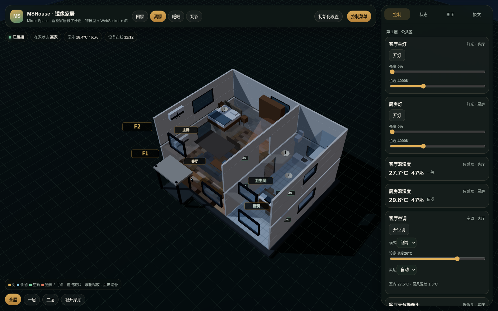

# MSHouse 镜像家居

**Mirror Space** 旗下的智能家居数字孪生教学场景 · Python 后端版 **1.0.0**

> 一栋两层小别墅的数字孪生：一层是客厅与厨房，二层是卧室与卫生间。
> 13 台设备通过统一 WebSocket 协议控制与上报状态，浏览器里可实时查看摄像头与人脸锁画面，
> 并支持回家 / 离家 / 睡眠 / 观影等场景。适合讲解**物联网通信、设备联动与数字孪生**。
>
> 大门人脸锁用 **SFace**（OpenCV Zoo，INT8 块量化）做识别，画面来源可选
> 静态图 / 本机摄像头 / 网络视频流 / **浏览器摄像头** —— 最后一种是让打开网页的
> 那台设备把自己的摄像头推给网关，适合网关本身没有摄像头的部署方式。



---

## 快速开始

```bash
pip install -r requirements.txt
python -m server.main
```

启动日志会打印**访问令牌**与**初始化口令**（都只打印一次）：

```
==============================================================
MSHouse 镜像家居 · 网关已启动
==============================================================
访问令牌：3f9c1a...
初始化设置口令（本次启动生成，仅显示一次）：7Qm4-Xr2Bk9LdPw
==============================================================
```

打开 <http://localhost:8080>，点右上角「**连接**」填入令牌。默认端口 8080，可用 `PORT` 覆盖。
想把令牌固定下来：`export MSHOUSE_TOKEN=你的令牌`，或写进 `config.toml` 的 `[security]` 段；
自定义初始化口令用 `python -m server.hash_password`。

跑一遍协议自检（**42 项**，含流通道端到端与浏览器推帧链路）：

```bash
export MSHOUSE_TOKEN=你的令牌                     # 自检需要令牌
python scripts/selfcheck.py                       # 默认 ws://127.0.0.1:8080/ws
python scripts/selfcheck.py ws://host:port/ws     # 指定地址
```

> **必须单 worker 运行。** 流通道订阅者与设备影子都在进程内存里，多 worker 会让每个进程
> 各持一份状态。渲染已经丢到线程池，不需要靠多进程扩吞吐。

---

## 目录结构

```
server/       main.py（FastAPI 入口）· gateway.py（设备影子/命令/场景/流信令）
              stream.py（MJPEG 通道）· model.py（★ 物模型与协议常量，唯一真源）
              vision.py（SFace 识别）· media.py（画面源：拉流 / 浏览器推流）
              security.py · validate.py · derived.py · render/（软光栅渲染）
models/       YuNet 检测 + SFace INT8 识别（随仓库提供，scripts/fetch_models.py 可重下）
public/       前端（Three.js 场景 + 控制面板 + 客户端 demo + js/browser-camera.js）
shared/       前端物模型（由 scripts/export_model.py 从 model.py 生成，勿手改）
scripts/      export_model.py · fetch_models.py · selfcheck.py（协议自检 42 项）
integrations/ ha_bridge.py（Home Assistant 桥接，MQTT Discovery，零侵入）
```

分层原则：**渲染层不认识协议，网关不认识像素** —— 浏览器一侧走 `/ws` 收发信令与命令，
另一侧用 `/?stream=<通道>` 取像素；`gateway.py`、`stream.py`、`render/` 各管一段，
换掉任何一层都不影响另外两层。

---

## 视频流：信令与像素分离

- **信令走 WebSocket**：只推「通道名 / 是否在推 / 云台角度 / 订阅数」，状态变化时才发；
- **像素走 HTTP 流**：`GET /?stream=<通道名>` 返回 `multipart/x-mixed-replace`，
  浏览器 `` 原生就能播，不需要 MSE / WebRTC。客厅 `233666`，大门锁 `233667`。

待机时通道也一直有画面（`STANDBY`），`` 连接不刷新，指令一到立刻切实景；
只有存在订阅者时才启动帧循环，一个通道渲染一次广播给所有观众，CPU 不随观看人数增长。
客厅画面里能看到入户门：门锁一开，门扇在画面中向室内转开，左下角常驻
`DOOR OPEN / DOOR LOCKED` 状态牌，云台转到任何角度都不会丢。

```json
{ "v": "1.0.0", "type": "command", "id": "ui-1", "payload": {
    "deviceId": "camera.living", "action": "stream", "params": { "on": true } } }
```

---

## 大门人脸锁

**识别流程**：YuNet 检测人脸 → `alignCrop` 摆正到 112×112 → SFace 输出 128 维特征 →
L2 归一化 → 余弦距离 `distance = 1 − cos`。**距离 ≤ 阈值即判为本人**，默认 `0.637`
（= OpenCV 官方示例推荐的余弦相似度 0.363，FAR ≈ 1e-5）。实测本人换光照 / 缩放 / 裁剪约
`0.05~0.30`，他人约 `0.64~1.15`，阈值落在中间很宽裕。模型缺失时 `/health` 的
`lock.face.backend` 会明确报错，不会静默退回其它方案。

**四种画面来源**（「设置 → 摄像头」里运行时切换，写进 `config.lock.json`，重启仍生效）：

| kind | 含义 | 画面怎么来 |
|---|---|---|
| `image` | 静态天气画面（默认） | 按当地天气与日出日落选的底图 |
| `camera` | 本机摄像头 | 网关所在机器的 `cv2.VideoCapture(index)` |
| `stream` | 网络视频流 | `cv2.VideoCapture(rtsp://...)`，门口旧摄像头 / NVR |
| `browser` | **浏览器摄像头** | 打开网页那台设备用 `getUserMedia` 抓帧，POST 给网关 |

`VideoSource`（拉流）与 `BrowserSource`（推流）是同一套鸭子接口
（`is_external / latest / status / open / close / target`），网关侧不关心画面是拉来的还是推来的。

**浏览器摄像头为什么是「浏览器往服务端推」**：浏览器里的摄像头没有可访问的 RTSP/HTTP 地址，
服务端也没法反向连进浏览器，所以方向反过来 —— `getUserMedia` → 隐藏 `<video>` → 每帧画到
canvas → `toBlob('image/jpeg')` → `POST /api/lock/frame`（默认 2fps）→ 网关当普通实时帧用：
渲染进 233667 通道，同时交给 SFace 识别。三个取舍：**像素走 HTTP 不走 WebSocket**（与 MJPEG
同一套分工）；**串行发帧**（上一帧没回来就不发下一帧，网络慢宁可掉帧率）；**推帧有闸门**
（只有大门锁处于「推送画面」时才发帧，开着摄像头只做预览时不发，避免白刷请求）。

> 浏览器只在 **https 或 localhost** 下才允许访问摄像头（浏览器安全策略，不是本项目的限制）。
> 用局域网 IP + http 打开页面时 `getUserMedia` 会被拒绝，前端会把原因翻成人话提示出来。

**人脸登记**：推送中检测到未登记人脸会弹横幅询问，确认后把那一帧的人脸**对齐成 112×112**
存进 `camera/faces/<用户名>.jpg`，重启后重新提特征的结果与登记时一致。设置页的「人脸锁」卡片
提供主动登记（上传照片 / 用浏览器摄像头抓拍 / 删除），对应接口：

| 方法 | 路径 | 说明 |
|---|---|---|
| `GET` | `/api/lock/faces` | 登记库现状（模型 / 阈值 / 用户清单），开放读取 |
| `POST` | `/api/lock/enroll?name=<名字>` | 登记，body 是图片，需 `X-Setup-Password` 头 |
| `DELETE` | `/api/lock/enroll?name=<名字>` | 删除（连带删掉磁盘上的人脸图），需同一口令头 |

`camera/face.jpg` 是内置登记照（**仓库里没有这个文件**，需要自己放一张五官清晰的正脸照）。
没有它也能用：`/health` 会提示「尚未登记人脸」，走上面的登记流程现场注册即可。

---

## 协议速览

所有报文共用一个信封：`{ v, type, ts, payload }`，命令类报文额外带 `id` / `ref` 用于关联。
`v` 的主版本与网关不一致会被以 `PROTOCOL_MISMATCH` 拒绝（close `4426`）。

| 方向 | type | 说明 |
|---|---|---|
| S→C | `hello` / `snapshot` | 握手（含协议版本、网关标识、是否已认证）/ 全量设备影子（认证后推送） |
| C→S | `command` | 设备控制：`{ deviceId, action, params }` |
| S→C | `ack` | 回执：受理为 `status: "ACCEPTED"` + `desired`/`delta`；失败为 `errorInfo` |
| S→C | `state` | 单设备状态推送，带 `stateKind`（`delta`/`full`/`confirmed`）与 `seq` |
| C→S / S→C | `scene` | 场景切换 |
| S→C | `video` | **流信令**（不含像素），只在状态变化时推 |
| S→C | `event` / `fault` / `ota` | 事件日志 / 设备故障 / 固件升级状态机 |
| S→C | `setup` / `setupAuth` / `faceEnroll` | 位置广播 / 口令询问 / 陌生脸登记询问 |
| C→S | `resync` / `setup` | 序号跳号后请求全量对齐 / 初始化设置（口令 + 经纬度） |
| C→S / S→C | `ping` / `pong` | 心跳（服务端每 20s 下发，3 次未回应以 `4408` 断开） |

令牌的三种携带方式：WebSocket 子协议 `bearer.<token>`（浏览器唯一能传凭据的地方）、
查询串 `?token=`、首帧 `hello.payload.token`。

---

## 配置

大部分行为在 `config.toml` 里，改完重启生效（画面来源例外，见上）：

| 段 | 关键项 | 说明 |
|---|---|---|
| `[server]` | `host` / `port` | 监听地址与端口（默认 `0.0.0.0:8080`） |
| `[security]` | `token` / `setup_password_hash` | 令牌与口令哈希；`allow_anonymous` 可关鉴权（仅限课堂演示），`allowed_origins` 是 CORS 白名单 |
| `[devices]` | `command_rate_limit` / `coalesce_window_ms` | 命令限流与出站合并窗口 |
| `[streams.*]` | `channel` / `fps` / `port` | 通道号、推流帧率、是否独立端口 |
| `[streams.lock_entry.source]` | `kind` / `index` / `url` | 画面来源启动默认值 |
| `[streams.lock_entry.face]` | `photo` / `threshold` | 内置登记照与判定阈值 |

---

## 文档

- **[docs/INTEGRATION.md](docs/INTEGRATION.md)** —— 完整接入指南：连接鉴权、命令两阶段、
  变化上报、流通道、初始化设置、故障排查，含可复制的报文样例。
- **[docs/HA_INTEGRATION.md](docs/HA_INTEGRATION.md)** —— 接入 Home Assistant（MQTT Discovery）。
- **`public/docs.html`** —— 网页版使用说明（启动后访问 `/docs.html`）。
